  

## About

Making whatever I can, for fun. Currently learning front-end development, [TypeScript](https://www.typescriptlang.org/), [Python](https://www.python.org/), CSS, and more.

  

## Knowledge

  
  
  
  
  
  
  

  

## Projects

**Heavenly Market** - Price engine for Stalzone. Keeps a private database of every listing and completed sale, served through its own API endpoint.

**Heavenly Studio** - Private editor for importing and exporting bot cards and advanced scripts. Everything stored locally.

**HeavenlyX** - Lightweight extension that bypasses forced age verification and locked content on various sites.

**Outlast Trials Simulator** - Standalone, browser-based replica of the radio objective.

**OBS YouTube Overlay** - Displays the currently playing YouTube video in OBS. Runs on a local server.

**Heavenly-UI** - Custom UI library for game modding, debugging, and reversing.

**YouTube+** - Enhancement suite for YouTube.

**Heavenly Engine** - Private, self-maintained custom [CE](https://github.com/cheat-engine/cheat-engine/) build.

  discord — deprecated

