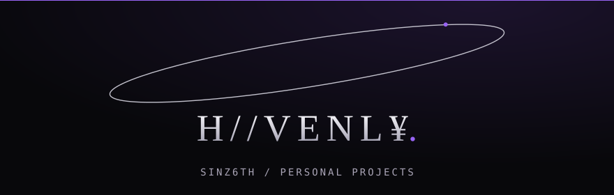
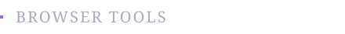
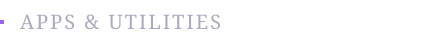
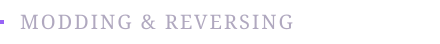

  

  Making whatever I can, for fun.

  Currently learning: 
  
  
  

  Interested in: 
  

  

  
  
  
  
  
  

## Projects

**HEAVENLY** 
Unofficial JanitorAI toolkit with message recovery, chat management, drafts, and browsing tools.

**YouTube+** 
Enhancement suite for YouTube.

**HeavenlyX** 
Lightweight extension that bypasses forced age verification and locked content on various sites.

 

**Heavenly Market** 
Stalzone auction tracker with price history, deal alerts, and a local market dashboard.

**Heavenly Studio** 
Private editor for bot cards and advanced scripts. Everything stored locally.

**Heavenly Reel** 
Bulk TikTok archiver with download queues, duplicate detection, and resume support.

**Heavenly Alts** 
Local Roblox account manager for Windows with multi-client launching and batch server joining.

**OBS YouTube Overlay** 
Displays the currently playing YouTube video in OBS through a local server.

**Outlast Trials Simulator** 
Standalone, browser-based replica of the radio objective.

**DDA Tower Calculator** 
Compares how Dungeon Defenders Awakened defenses scale with hero stats, using the game's own data.

 

**Heavenly-UI** 
Custom UI library for game modding, debugging, and reversing.

**Heavenly ZM** 
GSC mod menu for Zombies with player and gameplay controls.

**HeavenlyPD3** 
Configurable PAYDAY 3 mod collection for solo and offline play.

**DDA Tweaks** 
Dungeon Defenders Awakened modding tools for pak files, DataTable edits, and gameplay tuning.

**Heavenly Engine** 
Private, self-maintained custom [Cheat Engine](https://github.com/cheat-engine/cheat-engine/) build.

 

  SINZ6TH / HEAVENLY

